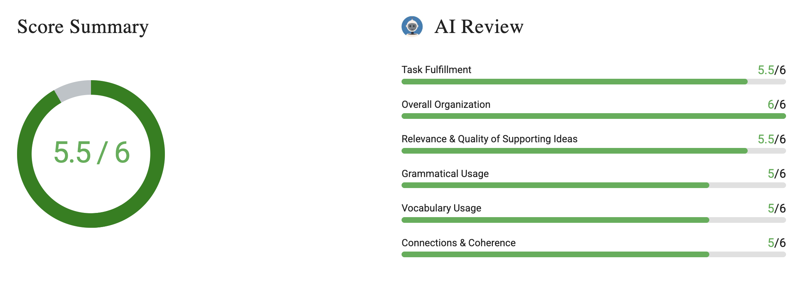

# Write an Email #3 Organizing Study Groups

# Question & Answer

Your statistics professor has encouraged students to form study groups before the midterm. You have reserved a library room, but you need to finalize the [meeting](https://www.bestmytest.com/toefl/toefl-writing-email/3#modal-vocab-lesson-meeting) details and the topics to review. Write an email to your classmates to organize the study session.

**Write an email to your classmates. In your email, do the following**

- Provide details of the reserved room and time
- Suggest specific topics or chapters to cover
- Ask classmates to confirm attendance and contribute materials

Write as much as you can and complete the sentences.

> 

Hello everyone,

I am writing this e-mail for detailing some of the points about our studies that we planned for midterm.

I reserved a library room. Number of this room is 202, and the location of this room is second floor in the main library, near the information desk. A man who takes the reservation requests, reserved there for Monday at 3 PM. Our session's duration is 6 hours. I hope we can complete all of the topics.

According to my plan, we can complete together Chapter 4, 5 and 6. Almost all of the questions will be asked in these chapters as the Professor said in the latest lecture. If the time remains in our reservation, we can also check the other chapters. If you have any other/additional ideas about our study session, we can discuss before beginning of the reservation.

Library provides us a projector, a computer and a whiteboard. You are free to bring your laptops, or any other study meterials. Snacks are provided from Professor.

If you attend or not, please write a response to this e-mail. According to your responses, I will update the reservation name list.

I look forward to hearing from you.

Best,

Uğur

# Review of the Writing

Hello everyone,

I am writing this e-mail **to detail** some of the points about our studies that we planned for midterm.

I reserved a library room. **The number** of this room is 202, and the location of this room is **on the** second floor in the main library, near the information desk. A man who takes the reservation **requests** reserved there for Monday at 3 PM. Our session's duration is 6 hours. I hope we can complete all of the topics.

According to my plan, we can complete together **Chapters** 4, **5,** and 6. Almost all of the questions will be asked in these chapters as the **professor** said in the latest lecture. If the time remains in our reservation, we can also check the other chapters. If you have any other/additional ideas about our study session, we can discuss **them** before **the** beginning of the reservation.

**The Library** provides us **with** a projector, a computer and a whiteboard. You are free to bring your **laptops** or any other study **materials**. Snacks are provided **by the professor**.

**Whether** you attend or not, please write a response to this e-mail. According to your responses, I will update the reservation name list.

I look forward to hearing from you.

Best,

Uğur

---

Hello everyone,

I am writing this e-mail to share some details about our planned midterm study session.

I reserved a library room for us. The room number is 202, and it is located on the second floor of the main library, near the information desk. The room is reserved for Monday at 3 PM, and our session will last for 6 hours. I hope we can cover all the topics we need.

According to my plan, we work through Chapters 4, 5, and 6 together. The professor said in the last lecture that most of the questions will come from these chapters. If we still have time left in our reservation, we can also review the other chapters. If you have any additional ideas for our study session, we can discuss them before the session begins.

The library provides a projector, a computer, and a whiteboard. You are welcome to bring your laptop or any other study materials. Snacks will be provided by the professor.

Please reply to this email whether or not you plan to attend. Based on your responses, I will update the reservation list.

I look forward to hearing from you.

Best,

Uğur

# Feedback

## **Task Fulfillment**

**Strengths**  

- You cover all three required task points.
- You give useful meeting details and name specific chapters.
- You ask classmates to reply about attendance.

Your classmates can find the meeting because you identify Room 202 in the main library. You also give the floor and the nearby information desk as clear location details. The meeting starts on Monday at 3 PM and lasts six hours. These details give classmates enough information to plan their attendance. Your suggestion to study “Chapter 4, 5 and 6” answers the request for specific chapters. You also explain that these chapters are important for the midterm. Finally, “please write a response to this e-mail” asks classmates to confirm whether they will attend.

**Weaknesses**

- The request for classmates to contribute materials is less direct than the attendance request.

“You are free to bring your laptops, or any other study meterials” gives permission. However, it does not clearly ask everyone to contribute something useful. A more direct request would be: “Please bring your notes or practice questions to share.” This would make the final task point clearer.

**Exercises for Improvement**

- Write one direct request for attendance and another for shared study materials. Check that each request tells classmates exactly what to do.

## Overall Organization

**Strengths**

- The email follows a clear order that suits the study-session task.
- Paragraphs separate meeting details, study plans, available materials, and attendance replies.
- The final request gives classmates a clear action after reading.

You begin by explaining that the email concerns plans for the midterm study session. Next, “I reserved a library room” starts the paragraph containing the place and time. Keeping these details together helps classmates find the meeting information quickly.

The next paragraph begins with “According to my plan” and introduces the chapters to review. This gives the study plan its own clear place after the meeting details. The paragraph beginning “Library provides us a projector” then groups information about equipment and materials. Classmates can easily find what is available and what they can bring.

Your final main paragraph asks classmates to reply about attendance. You then explain that their replies will help you update the reservation list. This is a useful order because readers learn about the session before deciding whether to attend. Each main part has a clear purpose, and the overall order is easy to follow.

**Weaknesses**

- No clear weaknesses were found in the overall organization of this response.

## Relevance & Quality of Supporting Ideas

**Strengths**

- Location details help classmates find the reserved room.
- You explain why Chapters 4, 5, and 6 should receive attention.
- Equipment details help classmates prepare for the session.

“Near the information desk” gives classmates a useful landmark beyond the room number. Your reference to the professor's latest lecture supports your choice of chapters. This gives classmates a reason to follow your proposed study plan. Mentioning “a projector, a computer and a whiteboard” also supports planning. These details show which tools the group can use during the meeting.

**Weaknesses**

- The six-hour study plan has little detail about how to use the time.
- The materials suggestion does not identify resources that would support the chosen chapters.

“I hope we can complete all of the topics” expresses a goal without explaining the plan. Classmates may not know whether you want to review notes or solve practice questions. You could add: “We can review each chapter, then solve practice questions together.”

“Any other study materials” is relevant but broad. Naming chapter notes, practice problems, or difficult homework questions would make this idea more useful. These examples would help classmates bring materials that match the planned review.

**Exercises for Improvement**

- Add one study activity for each chapter you plan to review.
- List three useful materials and explain briefly how the group could use each one.

## Grammatical Usage

**Strengths**

- Most sentences communicate the meeting plans clearly.
- You use several sentence patterns to explain plans and possible actions.

“I reserved a library room” uses the past tense correctly for a completed action. “If you have any other/additional ideas about our study session” correctly begins a sentence about a possible situation. You also use “we can” to suggest activities and “I will” to explain your next action. These patterns help readers understand your plans despite several grammar errors.

**Weaknesses**

- Some sentences are missing articles or use incorrect prepositions.
- A few verb patterns and sentence structures need correction.
- One comma separates the subject from its verb.

“For detailing” should be “to explain” in your opening sentence. Write: “I am writing to explain our plans for the midterm study session.” “Number of this room” needs an article, but “The room number is 202” is simpler. Change “is second floor” to “is on the second floor.”

“Snacks are provided from Professor” needs both a different preposition and an article. Write: “Snacks are provided by the professor.” “If you attend or not” should be “whether you will attend.” Also remove the comma after “requests” because it separates the subject from “reserved.”

**Exercises for Improvement**

- Rewrite the room description using “the” and “on” correctly.
- Practice requests beginning “Please tell me whether” and passive sentences using “provided by.”

## Vocabulary Usage

**Strengths**

- You use suitable words for organizing a library study session.
- Your equipment words give clear, specific information.

Words such as “reserved,” “chapters,” “lecture,” and “study session” fit the assigned situation. They help explain both the meeting arrangements and the planned review. “Projector,” “computer,” and “whiteboard” name useful equipment clearly. These specific words help classmates understand what will be available in the room.

**Weaknesses**

- Some word choices do not express your intended meaning naturally or precisely.
- One study-related word is misspelled.

“Complete together Chapter 4, 5 and 6” is understandable, but “review Chapters 4, 5, and 6 together” better describes studying before a test. Similarly, “check the other chapters” does not clearly describe the activity. “Review other chapters” would express your purpose more accurately.

“Almost all of the questions will be asked in these chapters” makes the source of the questions unclear. Write: “Most exam questions will cover these chapters.” “Reservation name list” is also an awkward phrase. “Attendance list” clearly names the list of people joining the session. Finally, change “meterials” to “materials.” These changes would make your planning language more precise without using difficult words.

**Exercises for Improvement**

- Practice useful pairs such as “review chapters,” “solve problems,” and “confirm attendance.”
- Rewrite three vague phrases using words that name the exact study activity.

## Connections & Coherence

**Strengths**

- You connect the chapter choices to the professor's advice.
- Conditional sentences connect extra activities to available time.
- You explain how attendance replies will affect your planning.

“As the Professor said in the latest lecture” connects your chapter choices to information from class. “If the time remains” shows that reviewing other chapters depends on finishing the main work. Near the end, “According to your responses” connects classmates' replies to updating the attendance list. These links help readers understand why you propose certain actions and what will happen next.

Weaknesses

- Some references make the connection between ideas less clear.
- One time reference does not clearly identify the intended event.

After giving the room details, you write that a staff member “reserved there.” The word “there” does not clearly name what was reserved. “The library staff confirmed this room for Monday at 3 PM” connects the booking directly to the room.

You also suggest discussing ideas “before beginning of the reservation.” Readers may wonder whether this means before Monday or just before studying. Write: “Please email your suggestions before Monday so we can agree on a plan.” This clearly links the suggestions, timing, and purpose.

**Exercises for Improvement**

- Check words such as “there” and “this” and identify exactly what each refers to.
- Rewrite timing statements using a clear event, such as “before the session starts.”
