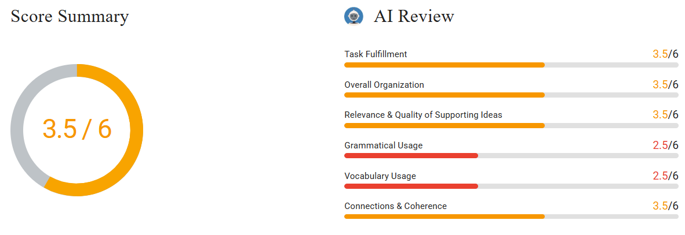

# Write an Email #4 Inviting to the Lecture

# Question & Answer

As president of your university’s Architecture Society, you want to invite [renowned](https://www.bestmytest.com/toefl/toefl-writing-email/4#modal-vocab-lesson-renown) architect Dr. Helen Ortiz to give a guest lecture on [sustainable](https://www.bestmytest.com/toefl/toefl-writing-email/4#modal-vocab-lesson-sustainable) design during Green Week next month. You must persuade her to accept, provide key details, and clarify logistical support the society can offer.

**Write an email to Dr. Ortiz. In your email, you should**

- Explain the purpose and date of the lecture
- Highlight why her expertise would benefit the audience
- Outline the logistical arrangements and request her confirmation

Write as much as you can and complete the sentences.

> 

Dear Dr. Ortiz,

My name is Uğur Altınışık. I am the president of ArchSociety in TOBB University of Economy and Technology. I am writing this email to invite our lecture as a guest lecturer.

The next week is named as Green Week in our university. During all week, we planned lectures proper this thema. If any of the student who study architecture researchs about sustainability in designs, they can find a name firstly: Dr. Helen Ortiz. So we are really pleased to see you who are one of the most-known person in this field.

To elaborate the organization, we thought your lecture for the opening day. We will start to the program on Monday at 11 AM. We will plan to take long brakes between these lectures, so our timeline is so flexible. You can choose a time period that you are available to attend. If you can share with us a time period for the lecture, my friends will set your flights. We have a small team for reservations in this organization. They will be in contact with you for the city transportation and accomodation after your confirmation.

I hope I can explain all of the points to the Green Week. We are thrilled to host you during this special day.

We look forward to your response,

Best regards,

Uğur

# Review of the Writing

Dear Dr. Ortiz,

My name is Uğur Altınışık. I am the president of ArchSociety **at** TOBB University of Economy and Technology. I am writing this email to **invite** you as a guest lecturer.

The next week is named Green Week **at** our university. During **the whole** week, we planned lectures proper **to** this **theme**. If any of the **students** who study architecture **researches** about sustainability in **design**, they can find a name firstly: Dr. Helen Ortiz. So we are really pleased to see **you,** who are one of the most-known **people** in this field.

To elaborate **on** the organization, we thought **of** your lecture for the opening day. We will start the program on Monday at 11 AM. We will plan to take long breaks between these lectures, so our timeline is so flexible. You can choose a time period that you are available to attend. If you can share with us a time period for the lecture, my friends will set your flights. We have a small team for reservations in this organization. They will be in contact with you for the city transportation and accommodation after your confirmation.

I hope I can explain all of the points about Green Week. We are thrilled to host you during this special day.

We look forward to your **response.**

Best regards,

Uğur

---

Dear Dr. Ortiz,

My name is Uğur Altınışık, and I am the president of ArchSociety at TOBB University of Economics and Technology. I am writing to invite you to join us as a guest lecturer.

Next month, our university will be holding Green Week. Throughout eh week, we have planned lectures related to this theme. For students studying architecture and researching sustainability in design, your name is one of the first that comes to mind. We would therefore be delighted to welcome you, as you are one of the most well-known figures in this field.

Regarding the organization, we are considering your lecture for the opening day of the event. The program will begin on Monday at 11:00 a.m. We will leave generous breaks between sessions, so the schedule will be flexible. You may choose the time slot that best suits your availability. If you could share your preferred time, my team will arrange your flight accordingly. We also have a small reservations team for this event, and they will contact you after your confirmation regarding transportation in the city and accommodation. 

I hope I have explained all the details about Green Week clearly. We would be honored to host you on this special occasion.

We look forward to your response.

Best Regards,

Uğur Altınışık

---

# Feedback

## **Task Fulfillment**

**Strengths**

- The email invites Dr. Ortiz and explains several travel arrangements.
- It asks for her availability and a response.

You identify yourself as the society president and invite Dr. Ortiz as a guest lecturer. Your reference to “sustainability in designs” connects her work to Green Week. You also offer flights, city transportation, and accommodation. These details help her understand the support available if she accepts. “We look forward to your response” asks her to reply.

**Weaknesses**

- The timing does not match the task, and the date remains unclear.
- The lecture purpose and audience benefits need clearer statements.

You write “next week,” but the lecture should happen next month. “Monday at 11 AM” does not give a full date. Write, “We invite you to speak on sustainable design on Monday, [date], next month.” Calling her well known does not fully explain what students would learn. Add, “Your examples would help architecture students design buildings that use less energy.”

**Exercises for Improvement**

## **Overall Organization**

**Strengths**

- The email follows a useful order from invitation to practical details.
- Most travel arrangements appear together in one section.

Your opening introduces your role and states that you are making an invitation. The next section discusses Green Week and Dr. Ortiz’s experience. You then move to the schedule, flights, transportation, and accommodation. This order helps the reader find the main parts of the invitation. The final lines return to your wish to host her and receive a reply.

**Weaknesses**

- The schedule and travel information share one crowded paragraph.
- The invitation details are spread across several parts of the email.

The paragraph beginning “To elaborate the organization” covers several different planning matters. Separate the lecture schedule from travel support so each section has one clear purpose. Also, place the topic and full date directly after the invitation. Currently, readers must collect this information from later sentences. A clearer order would be invitation and date, audience benefit, then arrangements and confirmation.

**Exercises for Improvement**

- Rewrite the email using three main paragraphs with the order suggested above.
- Label each paragraph with its purpose, then move any sentence that belongs elsewhere.

## **Relevance & Quality of Supporting Ideas**

**Strengths**

- The travel details give useful support for the invitation.
- The email connects Dr. Ortiz’s work with architecture students.

You explain that a team will arrange flights, city transportation, and accommodation. These details answer practical questions that could affect her decision to attend. The offer of a flexible time also shows that you consider her availability. Your sentence about students researching sustainability connects her expertise to the intended audience.

**Weaknesses**

- The praise does not explain a specific learning benefit.
- Some planning details remain too general to support her decision fully.

“One of the most-known person in this field” mainly describes her reputation. It does not show how her lecture would help students. Add a useful learning goal: “Your lecture could show students how to reduce energy use in buildings.” Also, “our timeline is so flexible” leaves the expected lecture length unclear. State a proposed length, such as a forty-minute talk followed by questions. This would make your invitation easier to consider.

**Exercises for Improvement**

- Write two specific things architecture students could learn from the lecture.
- Add one clear detail about the lecture length and one about the travel support.

## **Grammatical Usage**

**Strengths
• Some simple sentences and future forms communicate plans clearly.
“My name is Uğur Altınışık” correctly introduces the writer. “They will be in contact with you” also uses a correct future form. These sentences make parts of the invitation easy to understand. However, frequent errors elsewhere make the lecture invitation and schedule less clear.Weaknesses
• Missing words and incorrect prepositions weaken several important sentences.
• Singular and plural forms do not always agree.
“Invite our lecture” leaves out the person receiving the invitation. Write, “invite you to give a lecture.” In “start to the program,” remove “to”: “We will start the program on Monday.” The phrase “any of the student who study” needs a plural noun: “students who study architecture.” Also, change “one of the most-known person” to “one of the best-known people.” These repeated errors lower grammatical accuracy, even when readers can guess your meaning.Exercises for Improvement
• Practice patterns such as “invite someone to speak” and “start the program.”
• Write five sentences using “students who study” and “one of the people.”
• Check every noun after “one of” for a plural ending.**

## **Vocabulary Usage**

**Strengths
• Several words match the lecture topic and travel arrangements.
Words such as “sustainability,” “guest lecturer,” “reservations,” and “confirmation” are useful for this invitation. “City transportation” and “accommodation,” despite the spelling error in the latter, identify relevant travel needs. These choices help Dr. Ortiz understand some important parts of your offer.Weaknesses
• Several incorrect word choices make the invitation harder to understand.
• Spelling errors affect words needed for the topic and arrangements.
“Lectures proper this thema” does not clearly describe the Green Week program. Use “lectures about sustainable design” instead. “Long brakes” means something different from rest periods; the correct word is “breaks.” Also, “set your flights” is an unclear word combination. Write “book your flights” to describe the support directly. Replace “most-known” with “best-known,” and spell “accomodation” as “accommodation.” These errors are frequent enough to reduce the accuracy of your message.Exercises for Improvement
• Practice useful pairs: “give a lecture,” “book flights,” and “arrange accommodation.”
• Write sentences showing the difference between “brakes” and “breaks.”
• Rewrite the program description using “theme,” “sustainable design,” and “lecture.”**

## **Connections & Coherence**

**Strengths
• Several linking words connect the reasons and arrangements.
• Some references clearly connect related sentences.
“So” connects Dr. Ortiz’s reputation with your wish to host her. The sentence beginning “If you can share” links her availability with booking flights. After mentioning a small team, you use “They” to explain its responsibilities. These connections help readers follow the practical plans without repeating the same information.Weaknesses
• The relationship between the fixed start time and flexible timing is unclear.
• Some linking phrases do not clearly introduce the next idea.
You say the lecture is planned for opening day and the program starts at 11 AM. Then you say she can choose a time when she is available. Explain whether her lecture must begin at 11 or may happen later. For example, write, “The program starts at 11 AM, but your lecture can begin later.” Also, replace “To elaborate the organization” with “Regarding the lecture schedule.” This clearly connects the next sentences to the event plans.Exercises for Improvement
• Join the fixed start time and flexible lecture time using “but.”
• Underline each linking phrase and check whether it clearly matches the following idea.**
