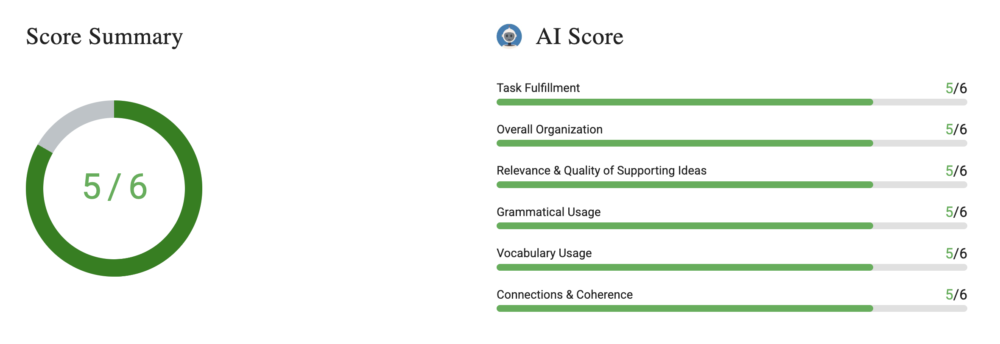

# Write an Email #7 Rescheduling Friday Project Meeting

# Question & Answer

Your group for the [Environmental](https://www.bestmytest.com/toefl/toefl-writing-email/7#modal-vocab-lesson-environmental) Economics project planned to meet in the library on Friday afternoon. However, you just learned that the library will be closed for maintenance that day. You need to inform your teammates, propose a new meeting location, and confirm everyone's availability.

**Write an email to your teammates. In your email, do the following**

- Explain why the original meeting cannot take place
- Suggest two alternative locations or times
- Ask them to reply with their preferred option

Write as much as you can and complete the sentences.

> 

Hello,

I am writing to change our meeting agenda about project. Last lecture, we planned to meet in the library on Friday afternoon, but I just learned that the library will be closed in that day. I quickly research other possible places where we can prepare project. I found 2 new options. I already check the availabilities, and here is the results of my searches:

- Coffee di Toe - 2.00 p.m. I usually work in there. Coffee shop has meeting rooms for 10 people. At 2.00 p.m that room is available for 4 hours.
- City Library - 08.00 a.m. There has just one non-silent room for our group project. So we need to arrive early.

Please evaluate our options quickly. If you have any additional opinions, please write me back quickly.

I am waiting your responses.

Best,

Uğur

# Review of the Writing

Hello,

I am writing to reschedule our meeting for the Environmental Economics project. Last lecture, we planned to meet in the library on Friday afternoon, but I just learned that the library will be closed on that day due to maintenance. I quickly looked into alternative places where we can work on our project. I found 2 new options. I have already checked availability, and here are the two options:

- Coffee di Toe - 2.00 p.m. I usually work there. Coffee shop has meeting rooms for 10 people. At 2.00 p.m that room is available for 4 hours.
- City Library - 08.00 a.m. There is only non-silent study room available for our group project. So we need to arrive early.

Please let me know which option works best for you as soon as possible. If you have any additional opinions, please write me back quickly.

I am waiting for your responses.

Best,

Uğur

---

Dear team,

I hope you are having a productive week.

I am writing regarding our project meeting initially scheduled for Friday afternoon in the library. I just found out that the library will be closed all day on Friday for maintenance, so our original plan cannot take place.

I looked into alternative arrangements and found two viable options:

- **Coffee di Toe (Friday at 2:00 PM):** It has dedicated meeting rooms that accommodate up to ten people, and a room is available for four hours.
- **City Library (Friday at 8:00 AM):** There is one discussion room where group work is permitted; however, we would need to meet early to secure it.

Please let me know which option suits your schedule best so that I can finalize the reservation.

Best regards,

Uğur

# Feedback

## **Task Fulfillment**

**Strengths**  

**Weaknesses**

**Exercises for Improvement**

## Overall Organization

**Strengths**

**Weaknesses**

**Exercises for Improvement**

## Relevance & Quality of Supporting Ideas

**Strengths**

**Weaknesses**

**Exercises for Improvement**

## Grammatical Usage

**Strengths**

**Weaknesses**

**Exercises for Improvement**

## Vocabulary Usage

**Strengths**

**Weaknesses**

**Exercises for Improvement**

## Connections & Coherence

**Strengths**

**Weaknesses**

**Exercises for Improvement**
