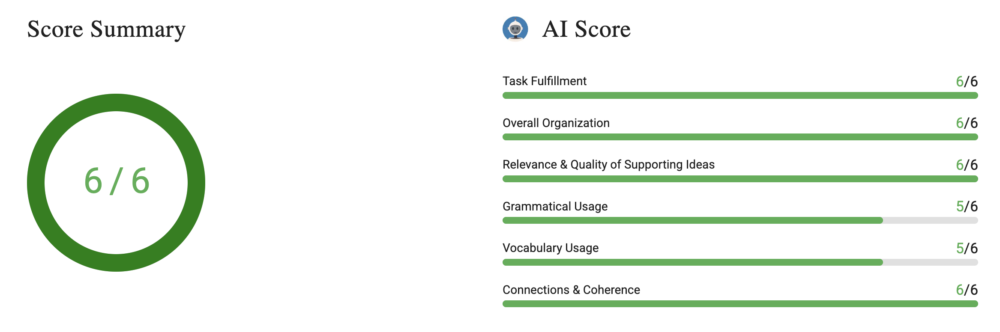

# Write an Email #9 Request for Extended Lab Hours

# Question & Answer

Your research methods class has been assigned a group experiment requiring specialized equipment in the campus chemistry lab. The only available booking slots conflict with your group’s lecture schedule, so you must write to the laboratory coordinator to request extended evening access.

**Write an email to the laboratory coordinator. In your email, do the following:**

- Explain the importance of the experiment
- Describe the scheduling conflict
- Offer to meet any additional safety or supervision requirements

Write as much as you can and complete the sentences.

> 

Dear Laboratory Coordinator,

I hope this email finds you well. I am Uğur Altınışık, a member of Group 7. I am writing to request extended evening access for Research Methods class experiment. I have already checked the available booking slots for chemistry lab. I just realized that there is just one avaliable slot remaining, and the available slot conflicts with our group's lecture. As you know, this group experiment is mandatory for this lecture, and we can just apply this only in the chemistry lab, because of the specialized equipment. If it is possible, we want to access the laboratory after 6.00 p.m. on Wednesday. We are fully prepared to meet any additional safety or supervision requirements.

I look forward to hearing from you.

Sincerely,

Uğur Altınışık

# Review of the Writing

Dear Laboratory Coordinator,

I hope this email finds you well. I am Uğur Altınışık, a member of Group 7. I am writing to request extended evening access for Research Methods class experiment. I have already checked the available booking slots for chemistry lab. I just realized that there is just one avaliable slot remaining, and the available slot conflicts with our group's lecture. As you know, this group experiment is mandatory for this lecture, and we can just apply this only in the chemistry lab, because of the specialized equipment. 
**If possible, we would greatly appreciate permission to access the laboratory after 6:00 PM this Wednesday.** We are fully prepared to meet any additional safety or supervision requirements.

I look forward to hearing from you.

Sincerely,

Uğur Altınışık

---

Dear Laboratory Coordinator,

I hope this email finds you well.

I am Uğur Altınışık, a student in the Research Methods course writing on behalf of Group 7. I am writing to kindly request extended evening access to the chemistry lab.

This upcoming experiment is a mandatory requirement for our course, and due to the specialized equipment involved, it can only be conducted in this facility. Unfortunately, the current booking slots directly conflict with our mandatory lecture schedule. If possible, our group would be extremely grateful to access the lab after 6:00 PM this Wednesday.

We are fully prepared to meet any additional safety or supervision requirements you may require during after-hours work.

Thank you for your time and assistance. I look forward to hearing from you.

Sincerely,

Uğur Altınışık

# Feedback

## **Task Fulfillment**

**Strengths**  

**Weaknesses**

**Exercises for Improvement**

## Overall Organization

**Strengths**

**Weaknesses**

**Exercises for Improvement**

## Relevance & Quality of Supporting Ideas

**Strengths**

**Weaknesses**

**Exercises for Improvement**

## Grammatical Usage

**Strengths**

**Weaknesses**

**Exercises for Improvement**

## Vocabulary Usage

**Strengths**

**Weaknesses**

**Exercises for Improvement**

## Connections & Coherence

**Strengths**

**Weaknesses**

**Exercises for Improvement**
