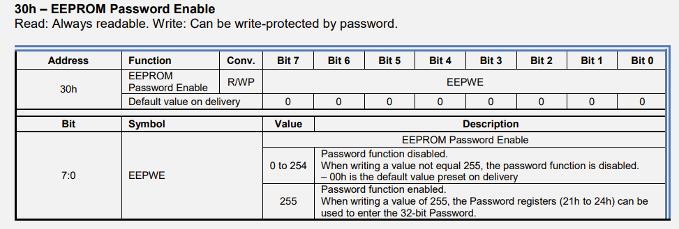
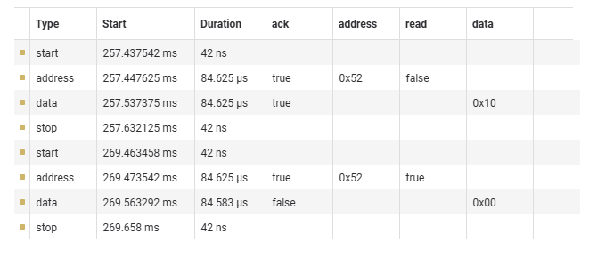
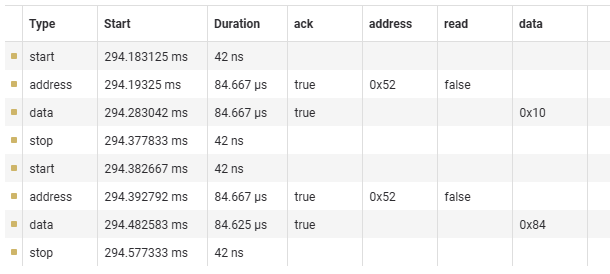
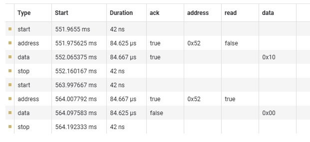
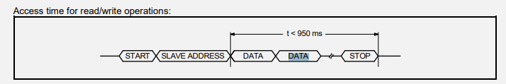

# Bug: I2CWrite Bug with RTC RV-3028

# Symptoms

- I2CWrite() function cannot write anything to the IC that is RV3028.
- We can read some values with I2CRead() and also we can write some values with I2CWrite() to another sensors.

# Analysis

### Password Dead-End

I realized a password mechanism for write protection. After reviewing this registers I realized number of the EEPWE is 0 that means password function disabled. We passed this possibilty.

### Deep Dive with Logic Analyzer

When i take different results, i decide to try Logic Analyzer for reviewing problem deeply. Here is my results:

- Firstly I try to obtain my requests I2C structures. So I observe the I2CRead() function packet structure in my packet.
  Here is the I2CRead() request:

  Packet structure is like this: 
**[Start Bit] [Address Frame] [R/W Bit] [Ack/Nack Bit] [Data Frame] [Ack/Nack Bit] [Stop Bit] 
    [1→0]               [0x52]          [write-0]        [ack-1]               [0x10]              [nack-1]          [0→1]
    [1→0]               [0x52]           [read-1]         [ack-1]               [0x00]             [nack-0]          [0→1]**

  Here is the I2CWrite() request:

  Packet structure is like this: 
**[Start Bit] [Address Frame] [R/W Bit] [Ack/Nack Bit] [Data Frame] [Ack/Nack Bit] [Stop Bit] 
    [1→0]               [0x52]           [write-0]          [ack-1]              [0x10]              [nack-0]          [0→1]
    [1→0]               [0x52]           [write-0]          [ack-1]              [0x84]              [nack-0]          [0→1]**

  Lastly I try to read the same register again for verifying to operation of writing to the register:

  Packet structure is like this: 
**[Start Bit] [Address Frame] [R/W Bit] [Ack/Nack Bit] [Data Frame] [Ack/Nack Bit] [Stop Bit] 
    [1→0]               [0x52]          [write-0]        [ack-1]               [0x10]              [nack-1]          [0→1]
    [1→0]               [0x52]           [read-1]         [ack-1]               [0x00]             [nack-0]          [0→1]**

  So I cannot set anything to this register.

- When we send the first write packet, sensor sets his pointer address to the given address number. After that, sensor waits to the value of the register. But value is given with the second packet, not in the same packet. When the sensor see stop bits, sensor take his pointer to the default address value. So we send the second packet, sensor understands this value as a new pointer address. 

# Solutions

I send this message as an array. So I use the MultiByteSend function.

# How to Prevent Next Time?

Read the docs before writing ur codes and everytime listen your system with logic analyser :)

# Documents

[https://drive.google.com/file/d/1jmdOqu4cRSeC1k2F4YZs7BUqg37QHwQt/view?usp=sharing](https://drive.google.com/file/d/1jmdOqu4cRSeC1k2F4YZs7BUqg37QHwQt/view?usp=sharing)
