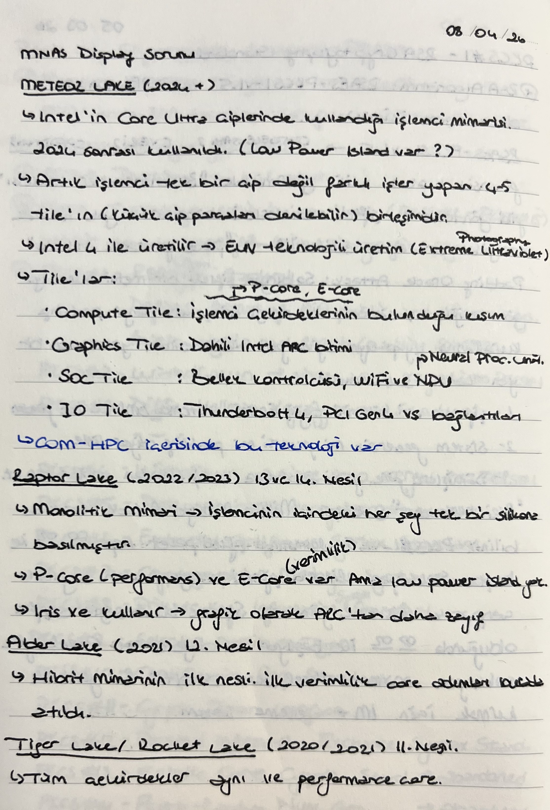

# Intel Processors Naming General Info

Intel'in isimlendirme dünyası aslında **4 ana katmandan** oluşur. En yukarıda tasarım felsefesi vardır, en aşağıda ise dükkandan satın aldığın modelin kodu yazar.

# 1. Katman: Tasarım Felsefesi

Bu katman, işlemcinin mimari olarak **nasıl bir mantıkla çalışacağını** belirleyen genel felsefelerdir. Yıllar boyunca kalıcı olurlar. 

### **CISC Mimarisi**

**1978-1995 arası** yani 8086’dan Pentium’a kadar bu mimariyi kullanmıştır. İşlemciye tek bir komut ile çok karmaşık işler yaptırmaktı. Yazılım boyutunu küçültmek amacıyla donanım karmaşıklaştırılmıştı. Zamanla RISC (Komutlar ne kadar basit olursa o kadar hızlı işlenir) felsefesi ağır bastı ve Intel CISC çalışmayı bıraktı.

### **CISC Dış Kabuk + RISC Çekirdek (Modern Simetrik x86)**

**1995’den günümüze** süregelen süreçte bu mimari kullanılmıştır. İlk örneği Pentium Pro’dur. Hibrit bir sistemdir. İşlemci dışarıya karşı CISC gibi davranır, böylece geçmişe dönük programları da sorunsuz çalıştırır. Ancak işlemcinin içindeki decoder bu karmaşık olan CISC komutlarını parçalayarak çekirdeğe  $\mu$op (mikro-operasyon) adı verilen minik RISC komutlarını gönderir. İşlemci içindeki tüm çekirdekler birbirinin aynısıdır. Yani bu mimarideki çekirdeklere **Homojen/Simetrik Çoklu Çekirdek** denir.

### EPIC (Explicitly Parallel Instruction Computing)

**2001-2021** arasında yani Itanium’dan IA-64’e kadar bu mimariyi kullanmıştır. Intel ve HP, x86'yı tamamen öldürüp sunucular için 64-bitlik yepyeni bir felsefe başlattı. Mantık şuydu: "Hangi komutların paralel çalışacağına işlemci anlık karar vermesin (Out-of-Order), buna derleyici (compiler) önceden karar verip işlemciye hazır sunsun.”. Bu felsefe sonucu derleyicileri yazmak çok zor oldu, x86 geriye uyumluluğu olmadığı için de sektör bunu dışladı. AMD'nin x86-64'ü (bugün kullandığımız 64-bit x86) çıkarmasıyla Itanium "Itanic" lakabını alarak tarihe gömüldü.

### Hibrit Mimari (Heterojen Çoklu Çekirdek)

2020 yılından günümüze süregelen süreçte bu mimari kullanılmıştır. Lakefield ile denenmiş, 2021 Alder Lake 12. Nesil ile ana akım olmuştur. Temel felsefe olarak akıllı telefonlardaki ARM (big.LITTLE) mantığı x86 dünyasına uyarlanmıştır. 

---

İşlemci çekirdeklerinin birbirleriyle olan ilişkisinin ve tasarım metodolojisinin adıdır. "Bu işlemci tek tip çekirdekten mi oluşuyor, yoksa farklı tip çekirdeklerin karışımı mı?" sorusunun cevabıdır.

**Intel bugün pazarda Modern/Gelenksel Simetrik ve Heterojen Çoklu Çekirdek/Hibrit felsefelerini kullanmaktadır. Bu iki yaklaşım tamamiyle ihtiyaç ve kullanım amacına göre farklı alanlarda kullanılmaktadır.**

Hibrit Mimari (Client / Son Kullanıcı Grubu)

- Masaüstü bilgisayarlar, laptoplar, el konsolları (Core Ultra, Core i5/i7/i9 serileri).
- Intel bu tarafta hibrit felsefesini kalıcı hale getirdi. Hatta son mimarilerde (Meteor Lake ve sonrasındaki Lunar Lake/Arrow Lake gibi) işlemciyi tek bir büyük çip yapmak yerine, TSMC ve Intel fabrikalarında ayrı ayrı üretilen farklı işlevsel blokları (Tile/Chiple) birleştirerek hibritliği fiziksel olarak da paketleme seviyesine çıkardı.

Geleneksel Simetrik Mimari (Veri Merkezi ve Edge Grubu)

- Sunucular, yapay zeka bulut altyapıları, endüstriyel gömülü sistemler (Xeon Scalable ve senin bahsettiğin gömülü sistem odaklı Xeon D serisi).
- Bu tarafta simetri hala kral. Görevlerin ne kadar sürede biteceğinin kesin olarak tahmin edilebilmesi (deterministic latency) ve tüm çekirdeklerin AVX-512, AMX (Matrix Extensions) gibi ağır yapay zeka/veri işleme komut setlerini eksiksiz koşturabilmesi için **Full P-Core** yapısı korunuyor.

**Not:** Intel son dönemde saf verimlilik odaklı sunucular için "Full E-Core" içeren Xeon modelleri (Sierra Forest gibi) de çıkardı; fakat orada da tüm çekirdekler yine kendi içinde **simetrik ve eşittir**, yani karma bir hibritlik sunucu tarafında iş yükü yönetimini zorlaştırdığı için tercih edilmiyor. 

# 2. Katman: Geliştirme Projeleri

Intel mühendislerinin laboratuvarda o nesli geliştirirken projeye verdikleri, genellikle ABD'deki nehir, göl veya tepelerden seçilen gizli proje adlarıdır.

---

Belirli bir **mikro-mimari neslinin ve üretim jenerasyonunun** kod adıdır. Örneğin, "Meteor Lake" dediğinde mühendis o çipin çiplet (lego) yapısında üretildiğini, içinde belirli bir üretim geometrisi ve belirli bir Thread Director versiyonu olduğunu anlar.

# 3. Katman: Markalama ve Segmentasyon

İşlemci fabrikadan çıktıktan sonra, son kullanıcının (veya kurumsal müşterinin) performans seviyesini ve hitap ettiği bütçeyi kolayca anlaması için verilen ticari unvanlardır.

### Son Kullanıcı (PC / Laptop / Taşınabilir Cihaz) Segmenti

Gündelik hayatta teknoloji mağazalarında gördüğümüz, ev ve iş yeri bilgisayarlarını hedefleyen markalar.

- **Intel Processor (Eski adıyla Celeron ve Pentium):** En alt segmenttir. Sadece webde gezinmek, Word/Excel kullanmak ve film izlemek için tasarlanmış, performansı çok kısıtlı ama en ucuz işlemci serisidir.
- **Core i3 / Core Ultra 3:** Giriş seviyesidir. Ofis bilgisayarları ve bütçe dostu okul laptoplarında tercih edilir. Temel işleri akıcı yapar.
- **Core i5 / Core Ultra 5:** Orta segmenttir. Fiyat/performans kralıdır. Ana akım oyunculuk, yazılım geliştirme ve günlük yoğun işler için sektörün en çok satan serisidir.
- **Core i7 / Core Ultra 7:** Üst segmenttir. Ağır kod derleme (compile), video kurgu, üst düzey oyunculuk ve mühendislik yazılımları için tasarlanmış kaslı işlemcilerdir.
- **Core i9 / Core Ultra 9:** Tepe (Zirve) segmenttir. Son kullanıcının alabileceği en yüksek performans sınıfıdır. Güç tüketimi ve sıcaklık dert edilmeden saf hız ve çekirdek gücü aranıyorsa bu seçilir.

> **Küçük Bir Not:** Intel, 14. nesilden sonra eski "i3, i5, i7, i9" isimlendirmesini yeni çiplet mimarili işlemcilerinde **"Core Ultra 3, 5, 7, 9"** olarak güncelledi. Mantık tamamen aynı kaldı, sadece isim modernize edildi.

### İş İstasyonu, Sunucu ve Endüstriyel Segment

Bu markalar mağazalarda tek başına satılmaz; büyük şirketler, veri merkezleri veya gömülü sistem üreticileri (savunma sanayii, telekom vb.) için üretilir.

- **Intel Xeon:** Sunucu, veri merkezi ve bulut altyapılarının mutlak hakimidir. Senin ilk başta sorduğun Xeon D-1700 gibi gömülü sistem modellerinden, binlerce çekirdekli yapay zeka sunucularına kadar geniş bir aileye sahiptir. 7/24 kesintisiz çalışmaya, hata düzeltmeli belleklere (ECC RAM) ve devasa veri yollarına odaklanır.
- **Akti̇f Olmayan / Eski̇yen Di̇ğer Markalar:**
  - **Itanium:** Az önce konuştuğumuz EPIC mimarisini kullanan eski sunucu serisiydi (Artık üretilmiyor).
  - **Atom:** Eskiden çok az güç tüketen küçük netbook'lar ve tabletler için üretilen bir alt segment markaydı. Intel şu an "Atom" markasını son kullanıcıda kullanmayı bıraktı, onun yerine bu çekirdek teknolojisini geliştirip yeni hibrit işlemcilerinin içine **E-Core** olarak gömdü.
- **Itanium:** Az önce konuştuğumuz EPIC mimarisini kullanan eski sunucu serisiydi (Artık üretilmiyor).
- **Atom:** Eskiden çok az güç tüketen küçük netbook'lar ve tabletler için üretilen bir alt segment markaydı. Intel şu an "Atom" markasını son kullanıcıda kullanmayı bıraktı, onun yerine bu çekirdek teknolojisini geliştirip yeni hibrit işlemcilerinin içine **E-Core** olarak gömdü.

---

**Not:** Mühendisler laboratuvarda bir mimari ve çekirdek tasarlarlar. Bunun az çekirdekli, dahili grafik kartlı versiyonunu yapıp laptoplara Core i7-1065G7 diye satarlar. Aynı çekirdek mimarisini alıp, grafik kartını söküp, yan yana 10-20 tane dizip senin ilk soruda sorduğun endüstriyel Xeon D-1700 işlemcisini yaparlar. Yani bir jenerasyon kodu, hem Core serisinde hem Xeon serisinde eş zamanlı (veya yakın zamanlı) olarak yaşar. Ancak sunucu dünyasının ihtiyaçları farklı olduğu için, Xeon tarafındaki kod adları bazen son kullanıcılardan farklı da seçilebilir (Örn: *Sapphire Rapids, Emerald Rapids* gibi sunucuya özel "Rapids" kod adları vardır).

**Not:** Intel, her yıl veya iki yılda bir işlemcilerinin mimarisini yeniler ve buna bir **Nesil Numarası** verir. 
"i7 12. Nesil" dediğin şey, Intel'in **2021-2022** yıllarında piyasaya sürdüğü, kod adı **"Alder Lake"** olan işlemci ailesinin Core i7 segmentindeki üyesidir. Bir işlemcinin kaçıncı nesil olduğunu anlamak için model numarasındaki ilk iki haneye bakarsın. Örneğin Core i7-12700K için 12. Nesil yani Alder Lake.

# 4. Katman: SKU / Model Numarası (Tam Kimlik Kartı)

Kutunun üzerinde yazan, dükkandan satın aldığın spesifik ürünün tam kodudur. İşlemcinin kimlik kartı ve model numarasıdır**.** Bu koda baktığında işlemcinin tam olarak kaçıncı nesil olduğunu, frekans hızını, çarpan kilidinin açık olup olmadığını (K serisi gibi) veya gömülü sistem/ağ odaklı olup olmadığını (NT serisi gibi) anlarsın. Örneğin Core i7-13700K, Xeon D-1749NT, Core Ultra 7 155H.

---

### Hepsini Tek Bir Örnekte Birleştirelim:

Bir bilgisayar satın aldın ve içinde **Intel Core i7-13700K** yazıyor. Bu işlemcinin anatomisi şudur:

- **Tasarım Felsefesi:** Hibrit Mimari (P-core ve E-core bir arada).
- **Kod Adı (Nesli):** Raptor Lake ailesinin bir üyesi (13. Nesil).
- **Marka / Segmenti:** Core i7 sınıfında (Üst-orta seviye performans canavarı).
- **SKU / Model Kodu:** 13700K (Hız aşırtmaya uygun masaüstü işlemcisi).
