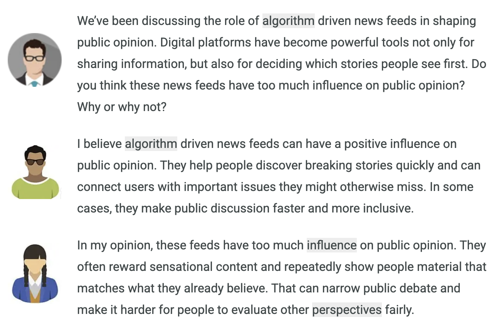
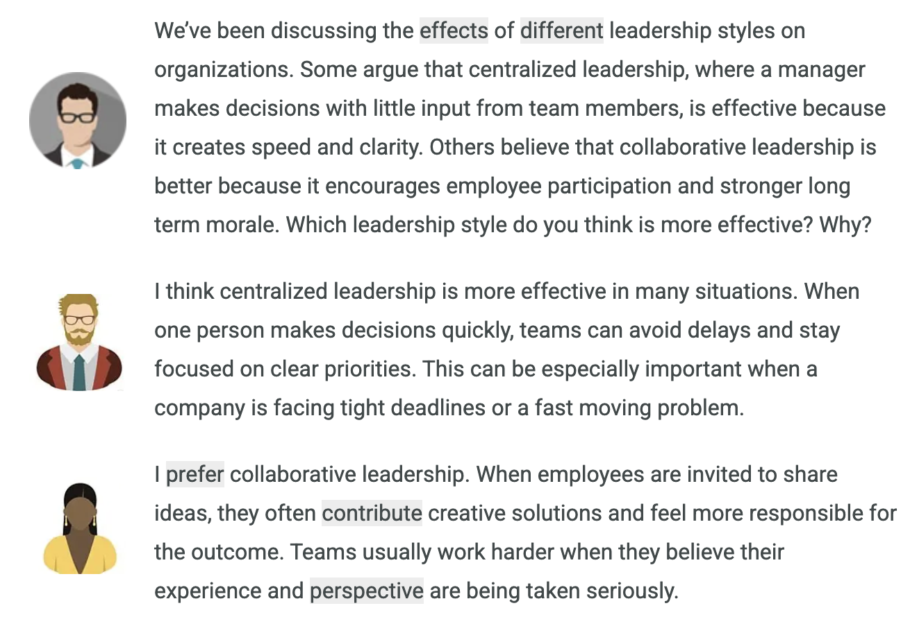
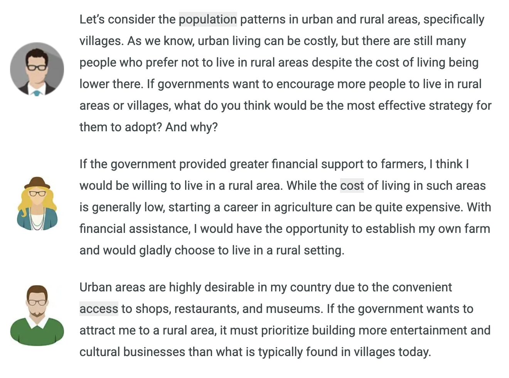
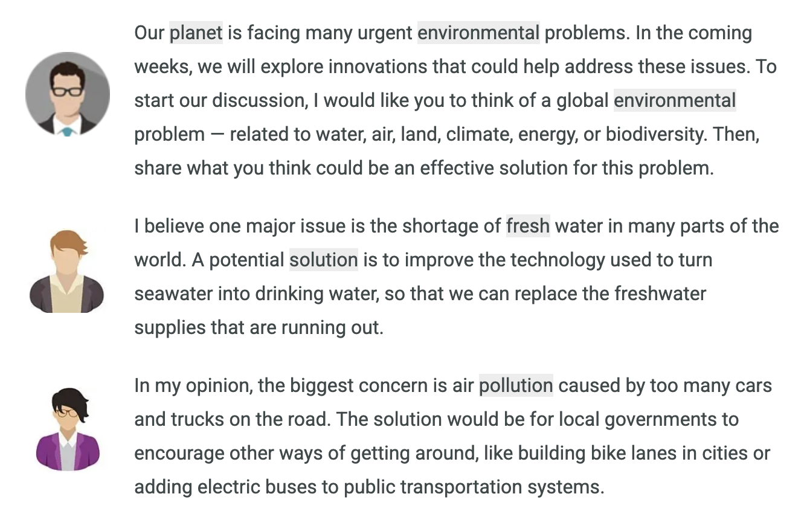
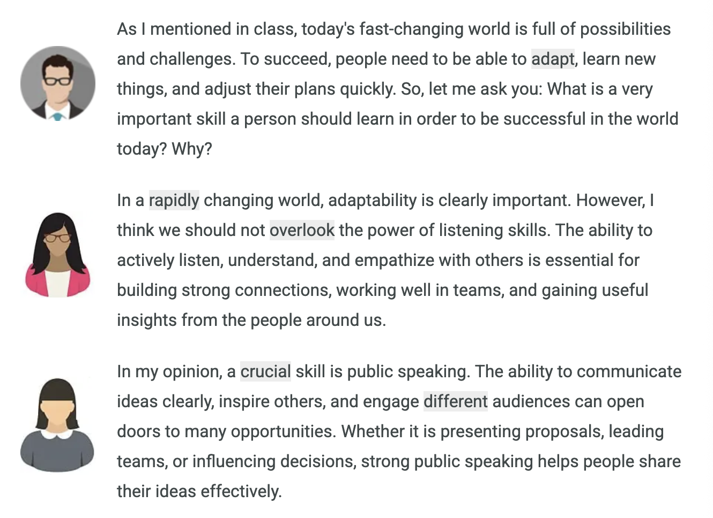
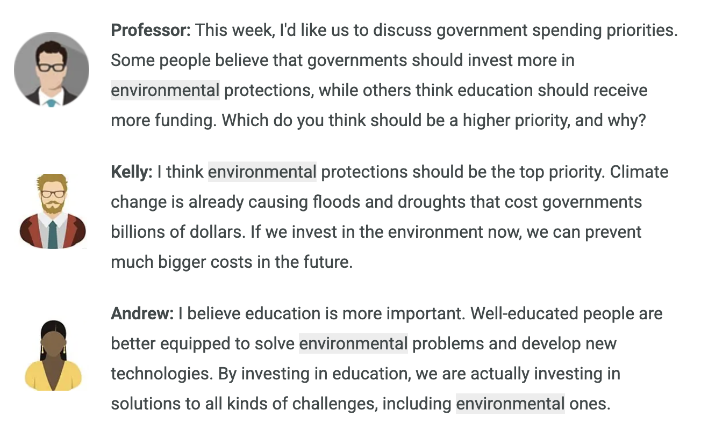

# Writing Practice

# Build a Sentence

# Write an Email

7 types of e-mail prompt:

- **Making an Inquiry or Request:** Ask for info, help a meeting
- **Providing Feedback with Suggestion:** Share your experience and recommend improvements.
- **Organizing or Asking for Help:**  
  - Ex. Planning a company picnic and asking coworkers to volunteer.
- **Expressing Appreciation:**  
  - Thank someone and discuss future plans
- **Giving Advice:** A friend asks for your opinion and respond thoughtfully.
- **Applying or Volunteering:**  
  - Ex. Applying to volunteer at an animal shelter.
- **Responding to a Concern:** Addresses someone’s problem with empathy and alter.

## Caution

1. Address all three bullet points. This is the most important one for scoring criteria.
2. Flow E-Mail logically. Opening → main details → closing action. Connect these smoothly with transitions.
3. Language use. Is your grammar accurate?

## Skeleton of E-Mail

1. **Introduce the context:** Start with greeting. Briefly state why you are writing.
  - “Thanks for …”
  - “I am writing to …”
  - “I wanted to let you know …”
  - “I heard about … from …”
2. **Share key details:** This is where you cover the first two bullet points. 
  - “Unfortunately …”
  - “On the top of that …”
  - “I particularly enjoyed …”
  - “One issue I noticed was …”
3. **Propose Next Steps:** Cover the third bullet point.
  - “Could you please …”
  - “For future events …”
  - “I would suggest …”
  - “Would it be possible to …”

---

### **Making an Inquiry or Request**

> 

### **Providing Feedback with Suggestion**

> 

### **Organizing or Asking for Help**  

> 

Hello ___,

I am writing this e-mail to …

*<bullet_1>*

*<bullet_2>*

*<bullet_3>*

*<ending_action>* (Whether you attend or not, please write a response to this e-mail. According to your responses, ___.)

I look forward to hearing from you.

Best,

Uğur

### **Expressing Appreciation**  

> 

### **Giving Advice**

> 

### **Applying or Volunteering**  

> 

### **Responding to a Concern**

> 

---

### Opening Pleasantries - Formal

- **I hope this email finds you well.**
- I appreciate you taking the time to read this.
- I know you have a busy schedule, so I will be brief .

### Complimentary Closes

Professional - Formal

- I look forward to your reply.
- **I look forward to hearing from you.**
- I await your response at your earliest convenience.
- I would appreciate your feedback on this matter.
- We look forward to a successful working relationship.

Daily Expressions

- Hope to hear from you soon.
- Let me know what you think.
- Drop me a line when you have a moment.
- Looking forward to catching up soon.

### Request Ending

Professional - Formal

- Would it be possible to + [VERB] …?
- I would be grateful if you could [VERB] …
- I was wondering if you might be able to + [VERB] …
- Could you kindly provide / send + [Noun] …?
- Would you mind + [VERB-ing] …?

Daily Expressions

- Can you + [VERB] …?
- Could you should / pass me + [NOUN] …?
- Any change you could + [VERB] …?
- Do you mind + [VERB-ing] …?
- Let me know if you can + [VERB] …

## Timeline for Writing an E-Mail

| Time Period | Activity |
|---|---|
| 00.00 - 01.00 | Read question, set skeleton, identify |
| 01.00 - 05.30 | Writing starts   1. Greeting and introduce the context   2. Bullet 1 and 2   3. Bullet 3   4. Closing |
| 05.30 - 06.20 | Check your bullet points |
| 06.20 - 07.00 | Polish language, tone, and grammar |

# Academic Discussion

5 types of Academic Discussion.

| Type | What You Do | How Often |
|---|---|---|
| **Opinion** | You agree or disagree with a statement and explain why | 50% of question |
| **Choosing an Approach** | You pick between two opinions and explain why one is better | 40% of questions |
| **Proposing a Solution** | You suggest a way to solve a problem | Rare |
| **Problems and Solutions** | You identify a problem and propose a solution | Rare |
| **Description and Explanation** | You explain why something is important or beneficial | Rare |

**Common Topics:**

- technology and society
- education
- business and economics
- health and wellness
- environment
- arts and culture

## Opinion

> Yes, I think these news feeds have too much influence because they do more than distribute information; they determine repetition. When the same kind of story is shown again and again, it begins to feel more important than topics that may actually deserve greater attention. That effect can shape opinion even when users believe they are freely choosing what to read. In addition, algorithms reward material that keeps people engaged, and intense reactions are often easier to produce than careful reflection. As a result, sensational claims can gain more visibility than quieter but more reliable reporting. The problem is not that technology shares news quickly. The problem is that invisible ranking systems now play a major role in deciding what seems urgent, normal, or widely believed.

- **Clear opinion:** Takes a position (too much influence) and states it in the first sentence.
- **New contribution:** Adds the idea that repetition, not just content, shapes belief — a point neither student raised.
- **Specific reasoning:** Explains how algorithms reward sensational content over careful reporting.
- **References the discussion:** Builds on the second student's point about narrow debate.
- **Good length:** ~130 words — concise but thorough.

## Choosing an Approach

> I think collaborative leadership is more effective in most organizations because modern work is often too specialized for one person to see every risk or opportunity alone. When employees contribute information early, leaders make better decisions and avoid mistakes that come from blind spots. Collaboration also builds commitment, because people are more likely to carry out a plan seriously if they helped shape it. That does not mean endless discussion. A strong collaborative leader still sets deadlines and makes final choices when needed. But the process is stronger because the decision is informed by different expertise. In the long term, that style creates both better ideas and a healthier workplace culture, which is why I believe it is more sustainable than a strictly top-down approach.

- **Clear choice:** Picks collaborative leadership and states it immediately.
- **New contribution:** Adds the idea that collaboration improves decisions by reducing blind spots — a point neither student raised.
- **Balanced reasoning:** Acknowledges that collaborative leaders still set deadlines and make final calls.
- **Logical flow:** Position → reason → supporting point → counterbalance → conclusion.

## Proposing a Solution

> I agree with the point about urban areas having better cultural offerings, but I think the solution goes beyond entertainment. To truly attract people to rural areas, governments should invest in essential services like healthcare, education, and high-speed internet. Many people avoid rural living not because of boredom, but because they worry about access to good hospitals and quality schools for their children. For example, if a village had a well-equipped medical clinic and reliable internet for remote work, more young professionals would consider moving there. While cultural businesses are important, a broader development approach that addresses these basic needs would make rural life not just affordable, but genuinely appealing to a wider range of people.

- **Clear solution:** Proposes investment in essential services (healthcare, education, internet).
- **New contribution:** Adds ideas not mentioned by either student.
- **Specific example:** "a well-equipped medical clinic and reliable internet for remote work."
- **Good length:** ~130 words — concise but thorough.

## Problems and Solutions

> Both students raise important environmental issues, but I would like to focus on a different problem: soil degradation. Healthy soil is essential for growing food, and in many regions, farming practices have damaged the soil so badly that crop production is declining. One effective solution is regenerative farming, which includes techniques like crop rotation and using natural fertilizers instead of chemicals. These methods restore nutrients to the soil and also help capture carbon from the atmosphere, which reduces the effects of climate change. To encourage farmers to adopt these practices, governments could offer financial rewards or tax benefits. This approach would protect our food supply while also helping the environment — addressing two problems at once.

- **Different problem:** Introduces soil degradation instead of repeating water or air pollution.
- **Clear solution:** Regenerative farming, explained in plain language.
- **Practical suggestion:** Government incentives to encourage adoption.
- **Connects ideas:** Shows how the solution addresses both food supply and climate change.

## Description and Explanation

> Both listening and public speaking are valuable skills, but I believe the most important skill for success today is effective written communication. In the modern workplace, much of our interaction happens through emails, reports, and online messages. A person who can write clearly and persuasively has a significant advantage. For example, during a job search, a well-written cover letter can make the difference between getting an interview and being overlooked. Once you have a job, the ability to write clear instructions, proposals, or updates helps you stand out and advance in your career. Unlike public speaking, writing is a skill you use every day in almost every profession. For this reason, I think developing strong writing skills is the most practical investment a person can make.

- **Different skill:** Introduces written communication instead of repeating listening or speaking.
- **Clear explanation:** Explains why this skill matters in the modern workplace.
- **Specific examples:** Cover letters, instructions, proposals.
- **Comparison:** Briefly contrasts with public speaking to strengthen the argument.

---

## Essay Structure

### Response Structure

Step 1: State your position

- 1-2 sentences. Clearly express your opinion, solution, or explanation. You can agree with a student, disagree, or offer a new perspective.

Step 2: Support your position

- 3-5 sentences. This is the most important part. Provice a reason, example, or explanation that supports your position. Use specific details - not vague statements. **The quality of this section has the biggest impact on your score.**

Step 3: Wrap up

- 1-2 sentences. Restate your main point or connect your idea back to the discussion. **This step is optional if you are running out of time**, but it helps your response feel complete.

**Target Length:** 120-130 words. 

> **[STEP 1 - POSITION]** I agree with Andrew that education should be a higher priority, but I would like to add another reason that he did not mention. **[STEP 2 - SUPPORT]** Universities do not just teach students — they also conduct important research. Much of the progress we have made in treating diseases, developing clean energy, and creating sustainable farming techniques has come from university research programs. When governments invest more in education, they are funding this research at the same time. This means education spending has a broader impact than environmental spending alone, because it produces solutions across many different fields. **[STEP 3 - WRAP UP]** For this reason, I believe that prioritizing education is the most effective way for governments to address environmental challenges and improve society as a whole.

## Semi-Formal Expressions

### Expressing Disagreement Respectfully

- While I understand where [name] is coming from, I tend to see it differently…
- I appreciate [name]’s viewpoint, but I hold a slightly different perspective…
- I see [name]’s point, but from my perspective, it seems that…
- Although I understand [name]’s position, I believe there are other factors to consider…
- I see the merit in [name]’s argument; however, I would argue that…
- [name]’s viewpoint certainly has its merits, but allow me to offer a different angle…

### Expressing Agreement and Building On It

- I agree with [name]’s point about…, and I would like to add…
- [name]’s perspective resonates with me because…
- Building on what [name] said, I think…
- In reference to what [name] mentioned, I would also point out that…
- [name]’s thoughts align with my own views, and I believe…
- I would like to add to[name]’s point about…

## Timeline for Writing an E-Mail

| Time Period | Activity |
|---|---|
| 00.00 - 02.00 | Read & Plan Read the professor’s question and both student posts. Decide: Do you agree with a student, disagree, or have a different idea? Think of one specific example you can use. |
| 02.00 - 08.00 | Write Follow the 3-step structure: state your position (1-2 sentences), support it with a reason and example (3-5 sentences), and wrap up (1-2 sentences). |
| 08.00 - 10.00 | Review Check for grammar and spelling mistakes. Make sure you referenced the discussion and added your own ideas. Confirm your response is at least 100 words. |
